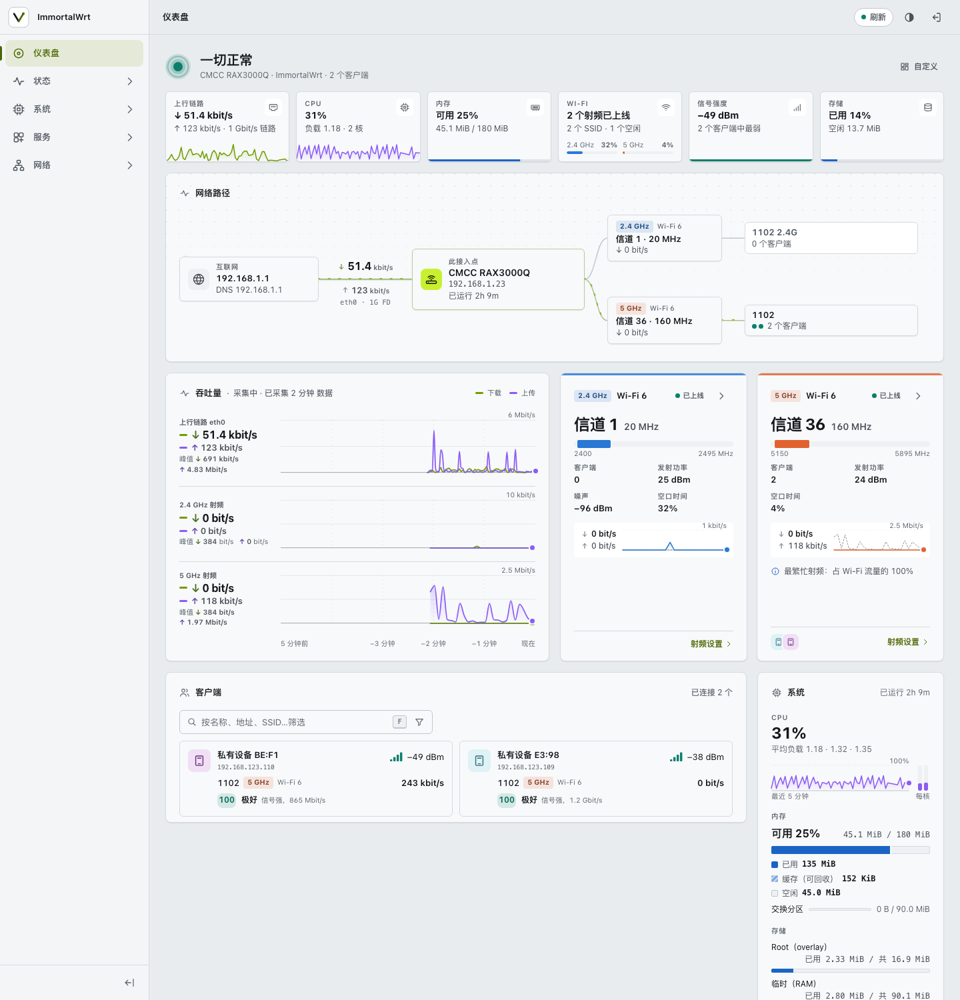
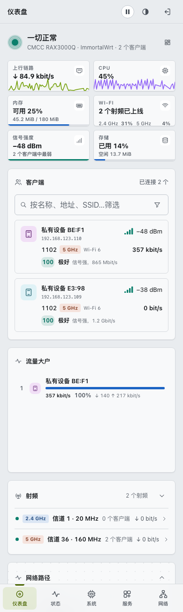
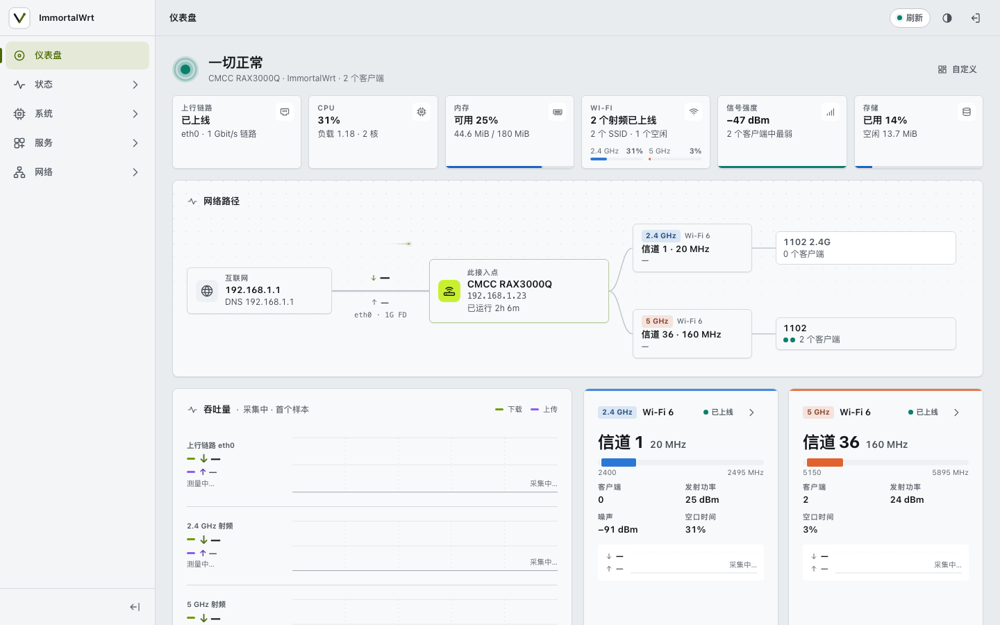

# luci-theme-vantage-21.02

[](https://github.com/zsyn666/luci-theme-vantage-21.02/actions/workflows/build.yml)
[](https://github.com/zsyn666/luci-theme-vantage-21.02/releases/latest)


**把 [anothaDev/luci-theme-vantage](https://github.com/anothaDev/luci-theme-vantage)（Vantage 主题 + 仪表盘）完整移植到 LuCI 21.02**。原版前端（24.10 的 ucode + JS 视图）一字未改，所有工作都在「兼容层」和「数据后端」里完成——因此 UI 的布局、样式、交互与原版保持一致，包括原版标志性的实时仪表盘。



实测运行环境：**CMCC RAX3000Q（Qualcomm IPQ5018）+ ImmortalWrt 21.02-SNAPSHOT，180MB 内存**，全部功能可用。

---

## 目录

- [功能一览](#功能一览)
- [截图](#截图)
- [安装](#安装)
- [兼容层原理](#兼容层原理)
- [数据后端](#数据后端)
- [中文本地化](#中文本地化)
- [本地构建](#本地构建)
- [CI/CD 自动构建与发版](#cicd-自动构建与发版)
- [目录结构](#目录结构)
- [已知限制](#已知限制)
- [致谢与许可证](#致谢与许可证)

---

## 功能一览

### 主题（移植自 luci-theme-vantage）

- **可折叠侧边栏**：图标 + 文字 + 子菜单，活跃项高亮条，`data-rail="pinned"` 展开态
- **页面标签页**：`网络 → 防火墙` 的「常规设置 / 端口转发 / …」分段控件
- **移动端适配**：≤900px 侧栏自动变底栏，顶栏下出现横向 chips 子导航，当前页自动滚动定位
- **深色模式**：跟随系统 `prefers-color-scheme`，顶栏按钮手动切换，`localStorage` 记忆
- **中文界面**：内置语言包（见[中文本地化](#中文本地化)），默认中文

### 仪表盘（luci-app-vantage 完整移植）

这是 Vantage 的灵魂，也是本次移植的核心工作量：

| 区块 | 内容 |
|---|---|
| **健康卡 × 6** | 上行链路（实时速率 + sparkline）、CPU（占用 + 负载 + sparkline）、内存（分段条）、Wi-Fi（射频/SSID 状态 + 频段条）、信号强度（弱信号告警）、存储（overlay 已用比例） |
| **网络路径** | 互联网 → 本机 → 各 SSID/有线分支的拓扑图，带动态连线、实时速率、每分支设备列表 |
| **吞吐量** | 上行链路 / 2.4G 射频 / 5G 射频三组多序列图，峰值刻度 + 时间轴，5 秒滚动采样 |
| **射频卡** | 信道频谱图（当前信道高亮）、客户端数、发射功率、空口时间、噪声、实时速率 sparkline |
| **客户端** | 名称/厂商/信号/速率/在线状态卡片，支持改名（`set_alias`）、静音弱信号告警（`set_quiet`）、按名称筛选 |
| **系统** | CPU 均分负载、内存分段（已用/缓存/空闲）、交换分区、overlay 存储 |

另有：**自定义面板**（隐藏/显示区块）、**命令抽屉**（点客户端或射频弹出详情）、**浅色/深色切换**。

> 首次加载后约 5–10 秒，CPU/吞吐图完成前两个采样点后开始显示实时数值——这是原版的设计（占用率需要两次采样做差值）。

## 截图

| 桌面端 | 移动端（390px） |
|---|---|
|  |  |

登录页（会话过期后自动落到）：



## 安装

### 从 Release 下载（推荐）

在 [Releases](https://github.com/zsyn666/luci-theme-vantage-21.02/releases) 下载最新的
`luci-theme-vantage_<版本>_all.ipk`，然后：

```sh
# 方式一：LuCI 网页 — 系统 → 软件包 → 上传软件包

# 方式二：命令行
scp luci-theme-vantage_*_all.ipk root@192.168.1.1:/tmp/
ssh root@192.168.1.1 'opkg install /tmp/luci-theme-vantage_*_all.ipk'
```

安装后刷新浏览器（Ctrl+Shift+R 清缓存），主题与「仪表盘」菜单即生效。

### 依赖

| 依赖 | 说明 |
|---|---|
| `luci-base` | 21.02 系（ImmortalWrt 21.02 / OpenWrt 21.02 均可） |
| `rpcd`、`rpcd-mod-file`、`rpcd-mod-iwinfo` | 标准组件，一般已内置 |

包内自带 `/usr/share/rpcd/acl.d/luci-app-vantage.json`（授予 `file.read /proc/stat` 等），
postinst **不会重启 rpcd**——重启会作废所有已登录会话；ACL 对新会话生效，旧会话缺权限时由
内置的 `fileread` 兜底接口自动补齐，无需任何手工干预。

### 卸载 / 回退

```sh
opkg remove luci-theme-vantage
```

postrm 自动把主题切回 Argon（无 Argon 则 Bootstrap），并清掉 LuCI 模板缓存。

## 兼容层原理

原版前端是 24.10 的 JS 视图（`view.extend` + 客户端渲染 + ucode 后端），21.02 缺一整套运行时。
移植策略：**前端文件原样部署，缺什么补什么**。

| 21.02 缺失 | 兼容实现 | 文件 |
|---|---|---|
| `view.js`（JS 视图基类） | 基于 baseclass 实现 `view.extend`，并用 `setPrototypeOf` 让 `instanceof View` 成立（`ui.instantiateView` 会校验） | `shim/view.js` |
| `dom.js`（DOM 助手） | `content / append / parse / elem` | `shim/dom.js` |
| `poll.js`（定时轮询） | `add / remove / start / stop` | `shim/poll.js` |
| `luci.vantage` ubus 对象（rpcd-mod-ucode） | rpc 桥接：`rpc.declare({object:'luci.vantage'})` 改写为 `fetch /admin/vantage/api`，按 `params` 数组做位置参数→命名参数映射 | `original.htm` |
| 24.10 数据字段 | `system.info` 补 `root/tmp`（存储卡）；`iwinfo.info` 的 `htmode` 用 netifd 配置覆盖（21.02 的 libiwinfo 认不出 HE，会把 Wi-Fi 6 报成 HT20）；`file.read` 被拒/为空时走只读白名单兜底 | `original.htm` + `model-vantage.lua` |

另外两处对原版行为的**最小**适配（均为挂载层补丁，不改原版文件）：

1. `render()` 会重建 DOM 但不清 `healthShape` 缓存，二次渲染时健康卡片区会空白——
   在 `View.prototype.render` 外包一层清缓存，并在挂载后强制补绘一次。
2. `LuCI.prototype.notifySessionExpiry`（核心弹出「会话已过期」遮挡层的入口）改为**静默重载当前页**：
   30 秒内最多一次、带时间戳防缓存。cookie 有效时页面自愈；真过期时自然落到登录页。
   同时全局捕获 `-32002 / Access denied` 类未处理异常，避免用户看到裸 RPC 报错。

## 数据后端

`luci/model/vantage.lua` 用 Lua 忠实复刻了 ucode 版 `luci.vantage` 的全部接口，
返回结构与原版逐字段一致（前端零感知）：

| 方法 | 返回结构 | 数据来源 |
|---|---|---|
| `wireless` | `{radio0: {up, config{band,channel,htmode,…}, interfaces[…]}, …}` | `ubus call network.wireless status` + `reduce_radio/reduce_iface` 逐字段裁剪（去除密钥）；netifd 不可用时回退读 `/etc/config/wireless` |
| `thermal` | `{zones:[{zone,type,temp}]}` | `/sys/class/thermal/thermal_zone*/{temp,type}` |
| `wired` | `{hosts:[{mac,port,bridge,vlan,seen}], switches}` | 解析 `/sys/class/net/*/brforward` 的 16 字节内核记录 + `/sys/class/net/<br>/brif/*/port_no` 端口映射；VLAN 设备映射到 swconfig 芯片端口 |
| `routes` | `{routes:[{family,dev,metric}]}` | `ip -4/-6 route get fibmatch <文档地址>`（首 token 为 `default` 等价于原版的 `dst==null` 判定） |
| `survey` | `{results:[{mhz,noise}]}` | `iw dev <ifname> survey dump`（只问带 `phy80211` 的接口，与原版一致） |
| `set_alias` / `set_quiet` | `{ok, op, mac}` | 写 `/etc/config/vantage`（带 512 条上限与输入校验） |
| `storage` | `{root:{total,used,avail}, tmp:{…}}`（KiB） | `statvfs`——21.02 的 `system.info` 没有 root/tmp 字段，前端 `model.mount()` 需要 |
| `htmode` | `{wlan0:"HE20", …}` | 供兼容层校正 iwinfo 的 Wi-Fi 代际显示 |
| `fileread` | `{data:"…"}` | 只读白名单：`/proc/stat`、`/proc/meminfo`、`/proc/loadavg`、`/proc/uptime` |

HTTP 端点：`/cgi-bin/luci/admin/vantage/api?method=<名称>`（LuCI 会话鉴权）。

## 中文本地化

21.02 的浏览器端 `_()` 是 `TR[sfh(context + '\u0001' + source)]`，且只加载 base 目录；
而 24.10 的 `vantage.zh-cn.lmo` 是新格式，21.02 读不了。

因此 `i18n/build-i18n.py` 把官方 `po/zh_Hans/*.po` 直接编译成一段 JS：
用**页面自带的 `sfh()`** 对每个 key 求哈希后合并进 `window.TR`。
每条译文同时登记「带上下文」和「纯文本」两种 key（前端调用方式与 po 的 `msgctxt`
并不一一对应，只登记单侧会大量漏译——实测 730 处调用，修复后 0 缺失）。

```sh
python3 i18n/build-i18n.py   # 官方 po → i18n/i18n-zh-cn.js（2082 条）
```

`i18n/i18n-zh-cn.js` 已提交到仓库，CI 每次构建都会从 po 重新生成。

## 本地构建

依赖：Python 3（标准库即可，无第三方包）。

```sh
# 1. 重新生成中文语言包（可选，仓库里已包含产物）
python3 i18n/build-i18n.py

# 2. 打包 ipk（输出到 dist/）
python3 build-ipk.py
# → dist/luci-theme-vantage_1.0.20-21.02r13_all.ipk
```

构建脚本完全自洽：主题静态资源在 `assets/`，原版前端快照在 `app/`，无需网络与 OpenWrt SDK。

## CI/CD 自动构建与发版

`.github/workflows/`：

| 工作流 | 触发 | 行为 |
|---|---|---|
| `build.yml` | push 到 main / PR / 手动 | 从 po 重新生成语言包 → 打包 ipk → 上传构建产物（保留 30 天） |
| `release.yml` | 推送 `v*` 标签 | 构建 ipk → 自动创建 GitHub Release 并附上安装包 |

发版只需：

```sh
git tag v1.0.20-21.02.13 && git push origin v1.0.20-21.02.13
```

## 目录结构

```
├── header.htm                  # 主题外壳上半（含会话自愈脚本）
├── footer.htm                  # 主题外壳下半
├── menu-vantage.js             # 21.02 版客户端菜单渲染
├── vantage-21.02.css           # 主题补丁样式（子导航/标签页/移动端）
├── vantage-dash.css            # 简易仪表盘（备用降级版）布局
├── dashboard.htm               # 简易仪表盘视图（Lua，/admin/vantage/simple）
├── original.htm                # 原版仪表盘挂载页（/admin/vantage 默认入口）
├── controller-vantage.lua      # 路由 + JSON 接口
├── model-vantage.lua           # luci.vantage 数据层（Lua 复刻 ucode 版）
├── build-ipk.py                # ipk 打包脚本（自洽，输出 dist/）
├── shim/                       # 21.02 缺失的 LuCI 模块兼容层
│   ├── view.js  dom.js  poll.js
├── app/                        # 原版 24.10 前端快照（一字未改）
│   ├── resources/vantage/*     #   12 个运行时模块 + app.css
│   └── resources/view/vantage/*#   overview.js / firewall.js
├── assets/                     # 主题静态资源（vantage.css/icons 等，取自原主题包）
├── i18n/                       # 官方 zh_Hans po + 编译脚本 + 产物
├── acl/                        # rpcd ACL（file.read /proc/stat 等）
└── shots/                      # README 截图
```

## 已知限制

1. **`survey`（噪声）** 依赖驱动：若驱动上报的噪声低于 −105 dBm（原版视为占位值），卡片不显示噪声行——与原版行为一致。
2. **客户端拓扑分支**：仅有无线客户端时不显示「有线网络」分支；插入有线设备后自动出现。
3. **`luci.getSwconfigPortState`** 需要交换芯片支持；本机双 swconfig（QCA MP + AR8337）可用。
4. 移动端已在 Chromium 1440/390 双断点验证（47 个后台页面 0 失败）；Safari/Firefox 未测。
5. 首次加载 CPU/吞吐图有 5–10 秒的「采集中」窗口（原版设计，需要两个采样点）。

## 致谢与许可证

- 上游主题与仪表盘：[anothaDev/luci-theme-vantage](https://github.com/anothaDev/luci-theme-vantage)（GPL-3.0-or-later）
- 主题样式与图标、原版前端 JS、官方中文 po 均来自上游项目，本仓库按同许可证分发
- 本仓库新增部分（21.02 兼容层、Lua 后端、打包脚本、CI）：同以 **GPL-3.0-or-later** 发布

详见 [LICENSE](LICENSE)。
